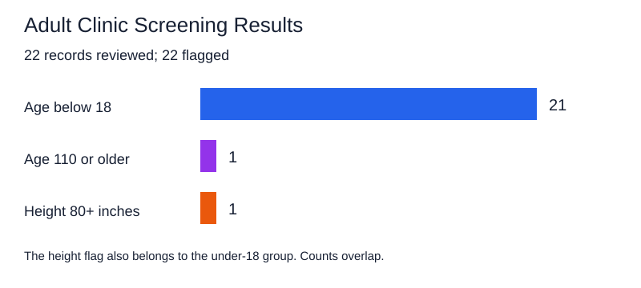

# Adult Clinic Record Screening

Author: Darrion Maurice Stringer
Date: 2026-10

Continuous Intelligence | Project 02 | Custom Report

Based on the example project by Denise Case.

## Overview

My question was: Which records would need review if the provided clinic file were submitted to an adult clinic?

I adapted the example by adding a minimum age rule and changing the upper age threshold.

## Data

I used the provided data/clinic_data.csv file containing 22 observations. Its columns are age_years and height_inches.

The dataset contains mostly children's ages. I kept the data unchanged and applied adult screening rules to check whether it fit the intended population.

[View the dataset](https://github.com/dstringer03/cintel-02-static-anomalies-custom/blob/main/data/clinic_data.csv)

## Methods

I used Python, Polars, reusable functions, Boolean filtering, logging, and CSV output.

I added an optional minimum age parameter to the detection function. The main pipeline flags a record if any condition applies:

- Age below 18 years.
- Age 110 years or older.
- Height 80 inches or taller.

I chose 18 as the minimum age for this adult screening exercise. The upper cutoffs flag unusually high values for review. These are classroom screening rules, not clinical standards.

## Results

The pipeline loaded 22 records and flagged all 22.

- 21 records had ages below 18.
- One record had an age of 120.
- One record also exceeded the height cutoff, with a height of 95 inches.

The height flag overlaps with the under-18 group, so the category counts should not be added together.

The pipeline saved the results to artifacts/anomalies.csv.

[View the flagged records](https://github.com/dstringer03/cintel-02-static-anomalies-custom/blob/main/artifacts/anomalies.csv)

## Results Chart

The chart summarizes the verified screening results.

## Interpretation

My main finding was that the provided dataset does not match the adult population defined by my rules. Most records were flagged because they belonged to children.

This does not mean every record is incorrect. It means the records need review before being used as adult clinic data.

## Limitations and Next Steps

The dataset is small and mostly pediatric, so it cannot show how well these rules work on typical adult records.

The pipeline does not explicitly check for missing values, duplicates, or unusually low heights. I also do not have confirmed anomaly labels to measure detection accuracy.

Next, I would use a representative adult dataset, add validation checks, and review the thresholds with someone familiar with the data.

## Earlier Threshold Experiment

Before applying adult rules, I increased the height cutoff from 72 to 80 inches while keeping the age cutoff at 16.

I predicted the anomaly count would drop from 3 to 2. That matched the actual result: the record with age 10 and height 72 inches was no longer flagged.

I learned that changing one threshold can change the results without changing the data. Fewer flags do not automatically mean better detection.

[View the experiment commit](https://github.com/dstringer03/cintel-02-static-anomalies-custom/commit/86e4f5b)

## Verification

The adult pipeline ran successfully and reported 22 flagged records. The automated test passed, the Git hooks passed, and the documentation built without issues.

## Run the Project

From the project root, run:

uv run python -m cintel.anomaly_detector

## Project Links

- [Repository](https://github.com/dstringer03/cintel-02-static-anomalies-custom)
- [README](https://github.com/dstringer03/cintel-02-static-anomalies-custom/blob/main/README.md)
- [Results and Artifacts](https://github.com/dstringer03/cintel-02-static-anomalies-custom/tree/main/artifacts)
- [Project Instructions](project-instructions.md)
- [Glossary](glossary.md)
- [API](api.md)
- [Professional Python Guide](https://denisecase.github.io/pro-analytics-02/)
